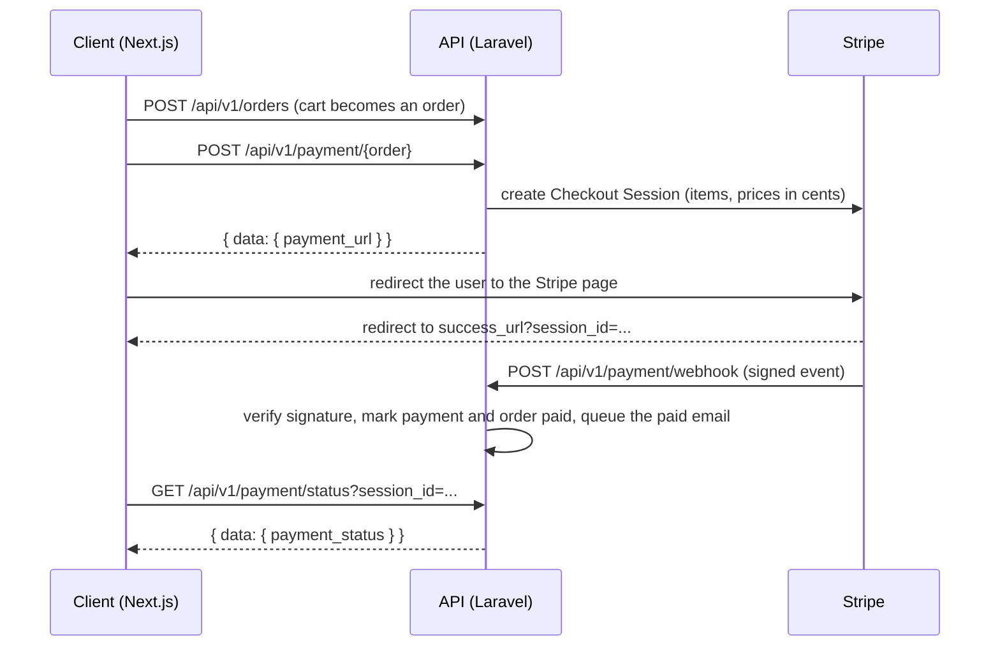

# Thirteen Flies


A multilingual e-commerce and content backend for a musical instruments store, built with Laravel. It has two faces: a versioned JSON API (`/api/v1`) for a separate Next.js storefront, and a Filament admin panel for the shop team. The API covers the whole buying path: catalog, cart, orders and real card payments through Stripe Checkout.

The goal of the project is to build a realistic shop backend the way it is done at work: money in cents, stock locked inside transactions, signed webhooks, queued emails, role-based access, SEO data and tests.

## Features

- **Catalog API:** products, categories (nested set tree), brands, discounts, promotions, filters, reviews and a wishlist, with listing filters and pagination
- **Auth with Sanctum tokens:** register, login (rate limited), logout, profile with avatar upload, address book
- **Cart and orders:** the cart becomes an order inside a database transaction. Prices are frozen at that moment, rows are locked with `lockForUpdate`, stock is reduced, and a pending order can be canceled to give the stock back
- **Stripe Checkout:** the API creates a Checkout Session and returns its URL. The order is marked paid only by a signed webhook, never by the client
- **Order emails:** queued notifications when an order is created, when its status changes and when it is paid
- **Multilingual content:** English, Spanish, Ukrainian and Russian (`?locale=`), with one slug per locale
- **SEO built in:** SEO templates, meta per model, redirects, sitemap and `robots.txt` endpoints
- **Filament 5 admin panel:** resources for catalog, content, SEO, orders (status editing) and customers (read only), with a dashboard, a pending-orders badge and roles and permissions from Filament Shield
- **Media handling:** Curator media library, images compressed by a queued job, files removed when the owning model is deleted
- **Generated API docs:** Scribe documentation with an OpenAPI file and a Postman collection
- **Tests:** Pest feature tests for the register, login, cart, order and checkout flow

## How a payment flows



The redirect back to the client proves nothing, because anyone can open that URL. The webhook is the source of truth, and the status endpoint is a safety net so the success page can show the right state.

## What is worth a look

### Order creation: `app/Http/Controllers/Api/V1/OrdersController.php`

One transaction locks the products, checks that they are active and in stock, freezes unit prices in cents, creates the order and its items, writes a status log, reduces the stock and empties the cart. Nothing is partly saved if one step fails.

### Payments: `app/Services/CreatePaymentUrl.php`, `app/Services/SetPaymentStatus.php`

`CreatePaymentUrl` builds the Checkout Session from the order items and stores a `Payment` row with the session id. `SetPaymentStatus` verifies the `Stripe-Signature` header against the raw body with `Webhook::constructEvent()`, finds the payment by session id and updates it. A bad signature gets a 400 and a log entry.

```php
// Payment model: when a payment becomes paid, the order follows
static::updated(function (Payment $payment): void {
    if ($payment->status === PaymentStatus::Paid) {
        $payment->order->update(['payment_status' => PaymentStatus::Paid]);
    }
});
```

### Authorization on payment routes

`POST /payment/{order}` loads the order through the current user (`$request->user()->orders()->findOrFail(...)`), so other people's orders return 404. The status endpoint validates that the `session_id` belongs to the user's own orders, and an already paid order returns 409.

### Model events and queued jobs: `app/Models/Sales/Order.php`

Order events dispatch jobs: `created` sends the confirmation (after commit), a changed `status` sends the status email and a `payment_status` change to paid sends the congratulations email.

### Shared model traits: `app/Models/Traits`

`Translatable`, `HasSlug`, `HasSeoMeta`, `HasMedia` and `HasFilterAttributes` give the catalog and content models the same features. The traits clean up their related rows when a model is deleted. `HasMedia` removes the media files too, unless another model still uses them.

### Locale: `app/Http/Middleware/SetLocale.php`

`?locale=` sets the app language (default `en`, and a 422 for an unsupported value). `ContentLocale` is the one place that decides the current content locale for the traits and the admin language switcher.

## API overview

All routes are under `/api/v1` and return JSON. Authenticated routes need `Authorization: Bearer <token>`.

| Area | Endpoints |
|---|---|
| Auth | `POST /register`, `POST /login`, `DELETE /logout` |
| Profile | `GET`, `PATCH`, `DELETE /profile` |
| Addresses | `GET`, `POST /addresses`, `GET`, `PATCH`, `DELETE /addresses/{address}` |
| Catalog | `/products`, `/categories`, `/brands`, `/discounts`, `/promotions` (each with a list, a single item, and filters or products where it applies) |
| Content | `/articles`, `/authors`, `/services`, `/pages` |
| Reviews | `GET`, `POST`, `PATCH`, `DELETE /review/{product}` |
| Wishlist | `GET /wishlist`, `POST`, `DELETE /wishlist/{product}` |
| Cart | `GET`, `DELETE /cart`, `POST`, `PATCH`, `DELETE /cart/{product}` |
| Orders | `GET`, `POST /orders`, `GET`, `PATCH /orders/{order}` (PATCH cancels) |
| Payment | `POST /payment/{order}`, `GET /payment/status`, `POST /payment/webhook` |
| SEO and site | `/config`, `/sitemap`, `/sitemap/lookup`, `/redirects`, `/redirects/lookup`, `/robots-txt` |

Full request and response details are in the generated docs at `/docs` (see Setup).

### Example: from registration to a payment link

```bash
# 1. register and keep the token
curl -X POST http://localhost:8000/api/v1/register \
  -H "Accept: application/json" \
  -d email=jane@example.com -d password=secret -d password_confirmation=secret

# 2. add a product to the cart
curl -X POST http://localhost:8000/api/v1/cart/1 \
  -H "Accept: application/json" -H "Authorization: Bearer <token>"

# 3. turn the cart into an order (needs one of your saved addresses)
curl -X POST http://localhost:8000/api/v1/orders \
  -H "Accept: application/json" -H "Authorization: Bearer <token>" \
  -d address_id=1

# 4. get a Stripe Checkout link for that order
curl -X POST http://localhost:8000/api/v1/payment/1 \
  -H "Accept: application/json" -H "Authorization: Bearer <token>"
# => { "data": { "payment_url": "https://checkout.stripe.com/c/pay/cs_test_..." } }
```

## Requirements

- PHP 8.4+ with `ext-pdo`
- Composer
- Node.js and npm (for the admin theme)
- SQLite (default) or MySQL / MariaDB
- A free [Stripe](https://stripe.com) account in **test mode** (sandbox) and the [Stripe CLI](https://docs.stripe.com/stripe-cli) for local webhooks

## Setup

```bash
git clone https://github.com/devalexmuha/thirteenflies.git
cd thirteenflies
composer setup          # install, .env, key, migrate, npm install and build
```

Add your Stripe sandbox keys and the frontend address to `.env`:

```ini
STRIPE_SECRET=sk_test_...
STRIPE_WEBHOOK_SECRET=whsec_...      # printed by `stripe listen`
FRONTEND_URL=http://localhost:3000   # where Stripe sends the user back

ADMIN_PATH=admin                     # admin panel URL, use a long random value in production
```

Seed demo data. `database/seeders/DatabaseSeeder.php` lists the seeders in the order they depend on each other. Uncomment the ones you need (admin, users, catalog, content...) and run:

```bash
php artisan db:seed
```

Run the app. `composer dev` starts the server, a queue worker (emails and image compression need it) and Vite:

```bash
composer dev
```

Receive Stripe webhooks locally in a second terminal:

```bash
stripe listen --forward-to http://localhost:8000/api/v1/payment/webhook
```

Test card: `4242 4242 4242 4242`, any future date and any CVC.

Generate and open the API docs:

```bash
php artisan scribe:generate     # then open /docs
```

The admin panel is at `/{ADMIN_PATH}` (default `/admin`).

## Tests

```bash
php artisan test --testsuite=Feature
```

`tests/Feature/CheckoutFlowTest.php` runs the buying path end to end: register, login, add to cart, create an order, start a checkout and confirm the payment with a correctly signed fake Stripe event. It also checks that a wrong webhook signature is rejected (400) and that a user cannot pay someone else's order. The Stripe call itself is mocked, so no network or real keys are needed. Tests use in-memory SQLite, a sync queue and array mail (see `phpunit.xml`).

## Project structure

```
├── app/
│   ├── Enums/              OrderStatus, PaymentStatus, Locale (with Filament colors)
│   ├── Filament/           admin resources, forms, tables and reusable components
│   ├── Http/
│   │   ├── Controllers/Api/V1/   API controllers
│   │   ├── Middleware/           AcceptOnlyJson, SetLocale
│   │   └── Resources/            API resources (JSON output)
│   ├── Jobs/               queued notifications and image compression
│   ├── Models/             Account, Catalog, Content, Filters, Sales, Seo (+ Traits)
│   ├── Notifications/      order created, changed and paid emails
│   ├── Policies/           generated from Filament Shield, grouped by domain
│   └── Services/           CreatePaymentUrl, SetPaymentStatus, FilterListing...
├── database/               migrations, factories, seeders
├── routes/api.php          the v1 API
└── tests/Feature/          Pest feature tests
```

## Known limitations and next steps

- Webhook events are not yet de-duplicated by event id (a `stripe_events` table exists for this). Repeating an event is harmless today because setting an already paid payment to paid changes nothing
- Only `checkout.session.completed` is handled. Expired sessions and delayed payment methods are not
- Rate limiting is applied to login and payment creation only
- No CI pipeline yet
- The Next.js storefront lives in a separate project

## Tech stack

Laravel 13 · PHP 8.4 · Filament 5 · Filament Shield · Laravel Sanctum · Stripe PHP SDK · Spatie Translatable and Settings · Filament Curator · Scribe · Pest · Laravel Pint

---

Built by [Alex Muha](https://github.com/devalexmuha) to learn how a real shop backend fits together: from the cart to a confirmed payment.
